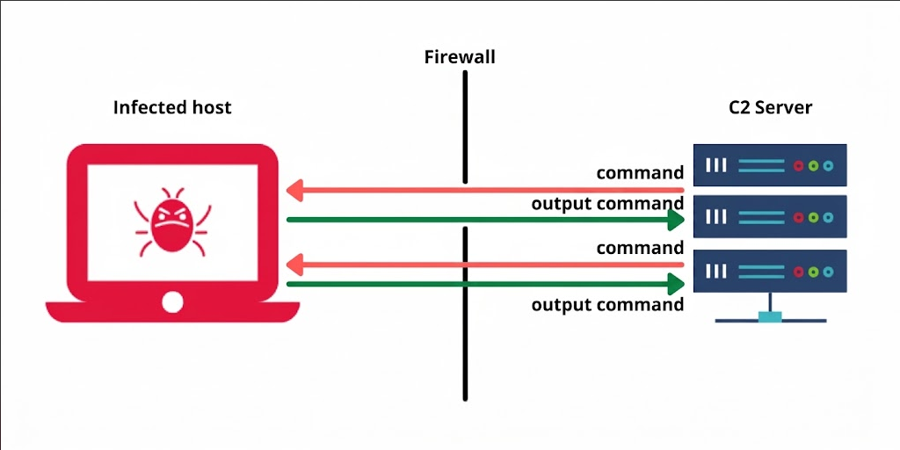

# Tool shell icmp


Esta es una herramienta que hice con el fin de seguir aprendiendo, y porque también me surgió una curiosidad de ver como podía usar este protocolo a mi gusto.

La herramienta es sencilla, actúa como un modelo cliente-servidor, donde, el **Sistema comprometido** se ejecuta y se queda **Escuchando** un paquete **ICMP** del **C2** con su respectivas características como el ID.


Figura 1-Diagrama ilustrativo.

Cuando el paquete **ICMP** cumple con esas caracteristicas, guarda el campo de datos de el encapsulado **ICMP** en texto plano, para tomarlo y ejecutarlo localmente.

Esto nos permite entre otras cosas poder ejecutar comandos sin que el firewall nos pueda llegar a bloquear ya que puede no analizar los datos de las cabeceras **ICMP**, a su vez, el protocolo no entabla conexiones, por lo tanto, no se puede analizar en herramientas como netstat o ss, esto nos muestra una ventaja grande en la postexplotacion frente al clasico reverse shell por tcp.


## Instalación (solo sistemas linux)

#### Paquetes necesarios
- scapy
- python3
- python3.13-venv (En el caso que el sistema sea debian o ubuntu)

#### Instalación

```zsh
git clone https://github.com/ninjaax86/Tool-shell-icmp.git

#Solo en sistemas basados en debian
sudo apt install python3.13-venv

sudo su

python3 -m venv .venv

source .venv/bin/activate

pip3 install scapy
```

#### Uso (Maquina cliente)
 ```bash
icmp_client.py [-t TARGET] [-i IFACE]
 ```

#### Uso (Maquina c2)
```bash
icmp_cnc.py [-t TARGET] [-i IFACE]
```
#### Parámetros
```
  -h, --help           Ayuda (Este menu)
  -t, --target TARGET  IP del objetivo
  -i, --iface IFACE    Interfaz a usar, default <interfaz_detectada>
```


### Video

[Video del PoC](https://youtu.be/1QsaWLAlI6Y?si=JG8Y7nbfu1uTbikj)

